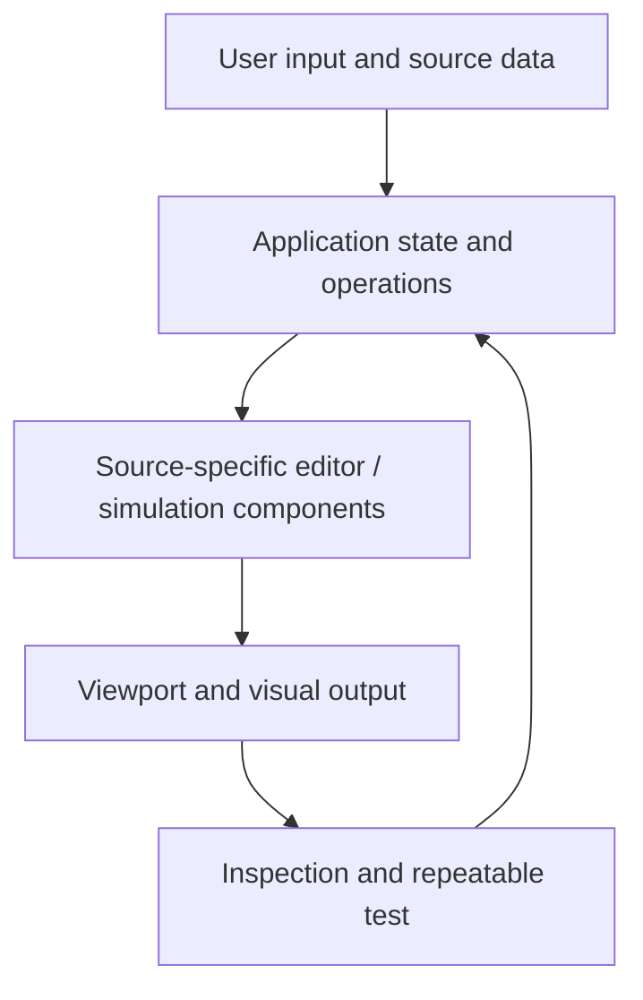

# WAVE TO 3D

### A splash should be a physical event, not a pre-rendered effect.

**Hybrid water-surface, WebGPU-oriented and particle-splash research**

A creative application has two responsibilities: produce a useful visual result, and preserve enough state to explain how that result was created. **WAVE TO 3D** explores that idea through the source and interface components checked into this repository.

> **Evidence boundary:** this README describes actual checked-in source modules, not a newly executed browser, native-GPU performance measurement or completed scientific/AI qualification. The repository originally shipped with a generic Lovable README; project-specific behavior must be tested against the running application.

**Start from source:** [Index.tsx](src/pages/Index.tsx) · [WaterScene.tsx](src/components/water/WaterScene.tsx) · [AnalystPanel.tsx](src/components/analyst/AnalystPanel.tsx)

---

## What is implemented

The checked-in app combines a React Three Fiber water scene, a surface simulation, splash particles, caustics, a sphere-drop interaction, and an analyst/capture panel. The index page manages a drop, splash, frozen capture and resumed motion. WebGPU-oriented modules and fallback paths coexist; their mere presence does not prove a functioning hardware WebGPU deployment.



| Concern | Source-grounded status |
|---|---|
| Application | Vite, React and TypeScript application, with an actual source entry and UI components |
| Interactive state | Implemented source-level controls and scene/editor state handling |
| Visual output | Browser-rendered canvas/scene path that requires runtime qualification |
| Reproducibility | Needs input fixtures, fixed interactions, logged errors and a repeatable capture workflow |
| Scientific or AI correctness | Not established simply by a source module or visible feature label |

## Run locally

```bash
npm install
npm run dev
# npm run build
```

Use the local address printed by Vite. These commands are the repository's declared setup pattern and have not been independently executed in this README edit.

## What still needs to be established

The best next technical gate is to capture the exact source in a real browser, report WebGPU/WebGL fallback selection and shader/console errors, then compare source-surface impulse and splash-particle accounting against a controlled drop. A saveable screenshot is useful evidence of the presentation, not proof of conservative fluid dynamics.

**The objective is a tool whose output is understandable, reproducible and open to technical scrutiny—not merely a convincing screenshot.**

---

*The previous generated starter README has been replaced; application code remains unchanged.*
